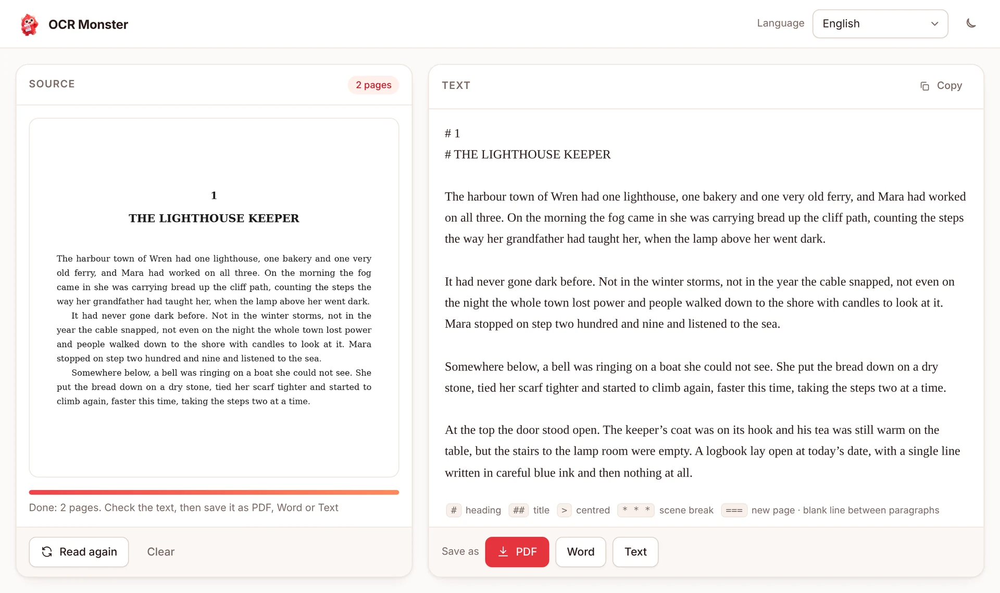
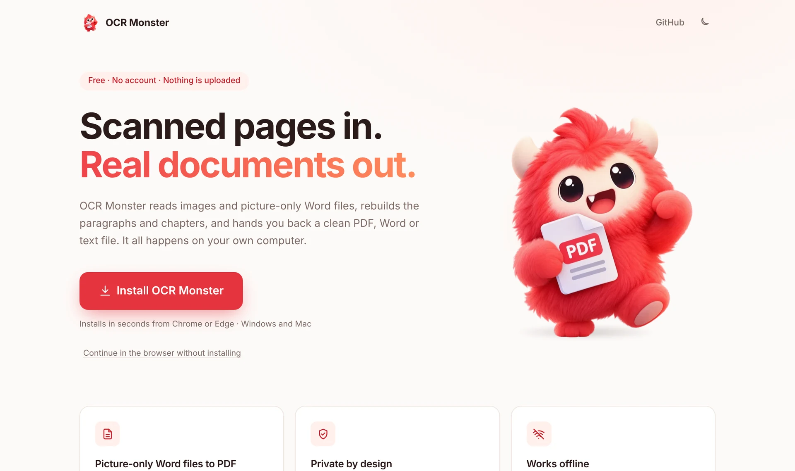

<div align="center">


<h1>OCR Magic</h1>

<p><strong>Scanned pages in. Real documents out.</strong></p>

<p>
Turn photos of pages and picture-only Word files into clean PDF, Word or text documents.<br />
Free, no account, and everything happens on your own computer.
</p>

<h3><a href="https://cosmo2357.github.io/ez-ocr/">Open OCR Magic →</a></h3>

<p>
<sub>Free · No sign-up · Nothing is uploaded · Works offline · Windows and Mac</sub>
</p>

<br />

<picture>
  <source media="(prefers-color-scheme: dark)" srcset="docs/app-dark.webp" />
  
</picture>

</div>

<br />

## What it does

<table>
<tr>
<td width="33%" valign="top">

**Picture-only Word files to PDF**

Some Word files contain no text at all, only a photo of every page. Drop one in and OCR Magic reads every page and stitches it back into flowing text.

</td>
<td width="33%" valign="top">

**Keeps the shape of the document**

Paragraphs, chapter headings, title pages, contents lists and scene breaks are rebuilt, so you get a document you can actually read and edit, not a wall of words.

</td>
<td width="33%" valign="top">

**Private by design**

The reading engine runs inside the app. Your files never leave your computer, there is no AI service behind it, and it keeps working without internet.

</td>
</tr>
</table>

## Get started in a minute

1. Open **[cosmo2357.github.io/ez-ocr](https://cosmo2357.github.io/ez-ocr/)** in **Chrome** or **Edge**.
2. Press the big **Install OCR Magic** button.
3. That is it. OCR Magic opens in its own window and from now on lives in your Start menu, Launchpad or desktop like any other app.

<div align="center">

</div>

<br />

> **Using Safari or Firefox?** Those browsers cannot install web apps with one click. On a Mac with Safari, choose **File → Add to Dock**. Otherwise press **Continue in the browser without installing** under the button and use it right there in the tab.

## Turn a file into a PDF

1. **Drop a file** into the window. A Word file (`.docx`), a single image, or a whole set of page images all work. You can also paste an image with Ctrl/Cmd+V.
2. **Wait while the pages are read.** A book chapter of 80 to 90 pages takes about two minutes.
3. **Check the flagged words.** Under the text you will see *spots to double-check*. Click one to jump straight to a word the reader was unsure about, compare it with the original and fix it if needed.
4. **Save.** Press **PDF**, **Word** or **Text**.

You can edit the text freely before saving. A few simple marks control the layout of the saved document:

| Mark | Meaning |
| --- | --- |
| `# ` | Chapter heading, starts a new page |
| `## ` | Big title |
| `> ` | Centred line |
| `* * *` | Scene break |
| `===` | New page |
| blank line | New paragraph |

## Good to know

**Is it really private?**  
Yes. Reading happens inside the app on your computer. Nothing is uploaded and no outside service sees your files.

**Does it need the internet?**  
Only the first time, to load the app. After you install it, it works offline.

**How accurate is it?**  
Very good on clean, printed pages, but no reader is perfect. Small raised letters such as the "th" in 4th and unusual symbols are the usual trouble spots, which is why the app lists the words it was unsure about. Proofread anything important.

**Which languages?**  
English by default, with Japanese available from the **Language** menu. Saving as PDF currently supports Latin-script text; for Japanese, save as Word or Text.

**Will the pages match the original?**  
The words will, the page numbers will not. The document is laid out fresh on A4 pages.

**Light or dark?**  
It follows your computer's setting. The sun/moon button in the top right switches it, and your choice is remembered.

<details>
<summary><strong>日本語での説明</strong></summary>

<br />

**OCR Magic** は、ページの写真や「画像だけでできた Word ファイル」を読み取って、編集できる PDF・Word・テキストに戻すアプリです。無料で、アカウント登録は不要です。処理はすべて自分のパソコンの中で行われ、ファイルが外部に送られることはありません。

**始め方**

1. Chrome か Edge で [cosmo2357.github.io/ez-ocr](https://cosmo2357.github.io/ez-ocr/) を開きます。
2. 大きな **Install OCR Magic** ボタンを押します。
3. 専用のウィンドウで開き、以後はスタートメニューや Launchpad から起動できます。インストール後はオフラインでも使えます。

**使い方**

1. Word ファイル（.docx）や画像をウィンドウにドラッグ＆ドロップします。
2. 読み取りが終わるまで待ちます（80〜90ページで2分ほど）。
3. テキストの下に出る要確認リストをクリックして、読み取りに自信のない語を原本と見比べます。
4. **PDF**、**Word**、**Text** のいずれかで保存します。

読み取り言語は右上の **Language** で日本語に切り替えられます。日本語の文書は、PDF ではなく Word かテキストで保存してください。

</details>

<details>
<summary><strong>For developers</strong></summary>

<br />

The repository is still named `ez-ocr`, the app's original name.

**Built with**

- [tesseract.js](https://github.com/naptha/tesseract.js): Tesseract OCR compiled to WebAssembly, with the language data bundled
- [fflate](https://github.com/101arrowz/fflate) to read and write `.docx`, and [pdf-lib](https://pdf-lib.js.org/) to write PDF
- [Vite](https://vite.dev/) for the web app, which is an installable PWA with a service worker for offline use
- [Tauri 2](https://tauri.app/) for the optional native desktop build

**Run it locally**

```bash
npm install
npm run dev
```

**Where things live**

| Path | What it is |
| --- | --- |
| `src/book.js` | Reads pages out of a `.docx`, runs OCR and rebuilds paragraphs and headings from the line positions |
| `src/exporters.js` | Writes the PDF, Word and text files in the browser |
| `src/main.js` | The interface, install flow and theme switch |
| `public/sw.js` | Offline cache |

**Publishing the web app**

Every push to `main` builds the site and deploys it to GitHub Pages (`.github/workflows/pages.yml`).

**Native desktop build (Tauri)**

The installers on the [Releases](https://github.com/Cosmo2357/ez-ocr/releases) page are the older v0.1.0 build, published as `ez-ocr`. It reads single images only and does not have the document features or the new design yet. The installed web app above is the recommended way to use OCR Magic.

To cut a new native release, bump `version` in `package.json`, `src-tauri/tauri.conf.json` and `src-tauri/Cargo.toml`, then tag and push:

```bash
git commit -am "v0.2.0"
git tag v0.2.0
git push origin main --tags
```

GitHub Actions builds the Windows and Mac installers and publishes them with `latest.json` for auto-update. The app is not signed with a developer certificate, so Windows and macOS show a warning on first launch. Saving files from the native build has not been tested yet.

The updater signing key lives at `~/.tauri/ez-ocr.key` (password in `~/.tauri/ez-ocr.key.password`) and is registered as the GitHub secrets `TAURI_SIGNING_PRIVATE_KEY` / `TAURI_SIGNING_PRIVATE_KEY_PASSWORD`. **If the key is lost, existing installs can no longer auto-update.** Back it up.

</details>
